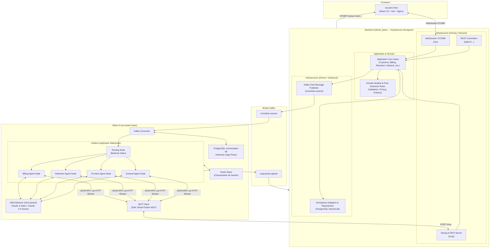

# Mounstro v3 — Agente de Atención al Cliente con IA

Sistema de atención al cliente omnicanal para empresas de telecomunicaciones. Integra un chat en tiempo real (**WebSocket/STOMP**), un backend en **Spring Boot 4 / Java 21** estructurado con **Arquitectura Hexagonal** y servidor **Spring AI MCP**, un cerebro de inteligencia artificial orquestado con **LangGraph** y **AWS Bedrock (boto3)**, y memoria conversacional de corto y largo plazo (**Redis + PostgreSQL**).

**Repositorio:** https://github.com/facuvgaa/agent-internet-ia

---

## 📐 Diagrama de Arquitectura



---

## ⚡ Flujo de un Mensaje

1. **Ingreso:** El usuario escribe en el chat (**React 19**) y envía su mensaje por WebSocket STOMP al endpoint `/app/chat` de **Spring Boot**.
2. **Despacho asíncrono:** Spring Boot valida el mensaje y lo publica en el topic Kafka `consultas.usuario`.
3. **Consumo y memoria:** `ia-master-brain` consume el evento:
   - Verifica el estado activo en **Redis** (`thread_id: {customer_id}`).
   - Si es una nueva conversación, recupera los últimos turnos desde **PostgreSQL** (`conversation_history`) para mantener continuidad de contexto.
4. **Ruteo y Ejecución:**
   - Si no hay un flujo en progreso, el nodo de `routing` clasifica el dominio con **Claude 3 Haiku**.
   - Se deriva al agente especializado correspondiente: `billing_agent`, `retention_agent`, `promise_agent` o `general_agent`.
5. **Tool-Use vía Model Context Protocol (MCP):**
   - El agente ejecuta las herramientas necesarias llamando al cliente MCP en Python, el cual invoca por HTTP el servidor **Spring AI MCP** alojado en `cliente_back`.
   - Cada tool ejecuta un caso de uso de dominio en el backend con validación estricta de titularidad.
6. **Respuesta:** La respuesta generada se publica en Kafka `respuestas.agente`.
7. **Entrega:** Spring Boot escucha la respuesta y la reenvía en tiempo real al navegador del cliente por `/user/{customerId}/queue/chat`.

---

## 🏛️ Arquitectura de los Componentes

### 1. `cliente_back` (Arquitectura Hexagonal)
Construido con **Java 21**, **Spring Boot 4.0.3**, **Spring AI MCP 2.1.0-M1** y **PostgreSQL**. Desacopla la lógica de negocio de los frameworks y persistencia:

```
cliente_back/src/main/java/com/cliente/cliente_back/
├── domain/                               # Núcleo de dominio puro (sin Spring/JPA)
│   ├── model/                           # Modelos de negocio (Customer, Billing, RetentionApplication...)
│   ├── service/                         # Reglas de negocio (DomainOwnershipValidator, RetentionPricingService...)
│   └── port/
│       ├── in/                          # Puertos de Entrada / Casos de uso (CustomerUseCase, BillingUseCase...)
│       └── out/                         # Puertos de Salida (CustomerRepositoryPort, ChatMessagePublisherPort...)
├── application/                         # Capa de aplicación y orquestación
│   ├── dto/                             # Data Transfer Objects (retention, addon, claims)
│   └── usecase/                         # Implementaciones de casos de uso inyectando puertos de salida
└── infrastructure/                      # Adaptadores tecnológicos
    ├── config/                          # Configuración de WebSocket STOMP
    ├── mcp/                             # Spring AI MCP Tools (@Tool) exponiendo puertos de entrada
    ├── messaging/kafka/                 # Adaptador publicador de Kafka y Listener de respuestas
    ├── persistence/                     # Entidades JPA, Repositorios Spring Data, Mappers y Adaptadores
    └── web/controller/                  # Controladores REST (/api/v1/internet-ia, /api/v1/retention, etc.)
```

### 2. `ia-master-brain` (Agente Reactivo Unificado)
Construido con **Python 3.12**, **LangGraph** y **AWS Bedrock**:
- **Sin dependencias legadas de LangChain:** Cliente nativo con `boto3` para invocar la API Converse de Bedrock.
- **Cliente MCP Oficial:** Utiliza la librería estándar `mcp` para comunicarse con el servidor Spring AI vía HTTP stream/SSE.
- **Grafo de Estado Unificado (`StateGraph`):**
  - `routing_node`: Identifica intención y conmuta de contexto sin pérdida de estado.
  - `billing_agent_node`: Consulta facturas y procesa reclamos de red/servicios.
  - `retention_agent_node`: Calcula elegibilidad, previews y aplica beneficios con cálculo de cashback.
  - `promise_agent_node`: Registra promesas de pago para reactivar conexiones suspendidas.
  - `general_agent_node`: Asistente de atención general sin acceso a datos sensibles.

### 3. `moustro-front` (Frontend Web)
- **React 19 + TypeScript + Vite + TailwindCSS 4**.
- Cliente WebSocket STOMP resiliente con auto-reconexión y tipado dinámico.
- Servidor de producción en contenedor ligero **Nginx Alpine** con reverse proxy para `/ws`.

---

## 🛠️ Herramientas MCP del Sistema

El servidor expone **16 herramientas nativas de negocio** consumidas por el agente de IA:

| Herramienta MCP | Dominio | Descripción |
|---|---|---|
| `get_customer_info` | Customer | Información general del cliente |
| `get_customer_service` | Services | Servicios activos, velocidades y planes |
| `billing_info` | Billing | Facturas emitidas, estados de pago y saldos |
| `billing_lookup` | Billing | Búsqueda puntual de factura por número |
| `create_ticket` | Tickets | Creación de tickets de reclamo técnico o comercial |
| `payment_promises` | Payment | Registro de promesa de pago y reactivación |
| `grant_mobile_topup` | Benefits | Acreditación de recarga de datos móviles de cortesía |
| `request_connection_reset` | Network | Solicitud de reseteo remoto de conexión |
| `run_network_diagnostic` | Network | Diagnóstico automatizado de señal, ONT y latencia |
| `list_network_diagnostics` | Network | Historial de diagnósticos realizados |
| `get_latest_network_diagnostic`| Network | Último resultado de diagnóstico registrado |
| `get_retention_tiers` | Retention | Niveles de retención configurados en el sistema |
| `get_retention_eligibility` | Retention | Cálculo de elegibilidad y porcentaje de descuento aplicable |
| `get_retention_preview` | Retention | Simulación de oferta y nuevo monto antes de confirmar |
| `apply_retention_agreement` | Retention | Aplicación formal del acuerdo de retención |
| `list_available_offerings` | Catalog | Ofertas y planes adicionales disponibles para contratar |

---

## 🐳 Servicios y Puertos

| Servicio | Contenedor | Tecnología | Puerto Host |
|---|---|---|---|
| Frontend | `moustro-front` | React 19 + Nginx | `80` |
| Backend API & MCP | `cliente-back` | Spring Boot 4 + Java 21 | `8080` |
| Motor IA | `ia-master-brain` | Python 3.12 + LangGraph | *(Worker interno)* |
| Message Broker | `kafka-internet` | Confluent Kafka 7.5 (KRaft) | `9092` |
| Base Principal | `postgrest-agent` | PostgreSQL 15 | `5432` |
| Base Conversaciones | `conversations_db`| PostgreSQL 15 | `5433` |
| Cache & Memoria | `redis_memory` | Redis Stack | `6379` |

---

## 🚀 Despliegue y Ejecución

### Prerrequisitos
- [Docker](https://docs.docker.com/get-docker/) y Docker Compose v2+.
- Credenciales de **AWS Bedrock** con acceso a modelos Anthropic Claude (`claude-3-haiku` y `claude-sonnet-4-6`).

### 1. Variables de Entorno
Copia el archivo de ejemplo y completa tus credenciales:
```bash
cp .env.example .env
```
Edita `.env`:
```env
AWS_ACCESS_KEY_ID=tu_access_key
AWS_SECRET_ACCESS_KEY=tu_secret_key
AWS_REGION=us-east-1
```

### 2. Modo Desarrollo (Build Local)
Para compilar y levantar todos los servicios desde el código fuente:
```bash
docker compose up --build
```
Acceso a la interfaz web: **http://localhost**

### 3. Modo Producción (Imágenes desde GHCR)
Para desplegar en servidores sin compilar código localmente:
```bash
docker compose -f docker-compose.prod.yml pull
docker compose -f docker-compose.prod.yml up -d
```

---

## 🔄 Pipeline CI/CD

El repositorio cuenta con integración y entrega continua configuradas mediante **GitHub Actions**:

- **CI (`.github/workflows/ci.yml`)**:
  - Compilación y verificación sintáctica de Python 3.12.
  - Validación de compilación del grafo unificado de LangGraph.
  - Ejecución de la suite completa de pruebas unitarias e integradas con `./mvnw clean verify` (32 tests en verde).
  - Linter y build de producción de Frontend (`npm run lint` & `npm run build`).
  - Verificación de build de imágenes Docker en paralelo con caché Buildx.
- **CD (`.github/workflows/cd.yml`)**:
  - Se ejecuta automáticamente ante cada merge a `main` o tag de release (`v*.*.*`).
  - Construye y publica las imágenes multi-contenedor en **GitHub Container Registry (`ghcr.io`)** con tags `latest` y `sha-<commit>`.
  - Soporte de despliegue automatizado por SSH en servidores remotos si se configuran los secrets (`SSH_HOST`, `SSH_USER`, `SSH_KEY`).

---

## 📄 Licencia

MIT License — Copyright (c) 2026 Facundo Vega

Se permite el uso, copia, modificación, fusión, publicación, distribución, sublicencia y/o venta del software, siempre que se incluya este aviso de copyright en todas las copias o partes sustanciales del software.

---
---

# Mounstro v3 — AI-Powered Customer Service Agent (English)

Omnichannel conversational customer service system for telecommunication companies. Features real-time chat (**WebSocket/STOMP**), a **Spring Boot 4 / Java 21** backend structured in **Hexagonal Architecture** with a **Spring AI MCP Server**, an AI engine orchestrated with **LangGraph** and **AWS Bedrock (boto3)**, and dual-layer memory (**Redis + PostgreSQL**).

---

## ⚡ Message Flow

1. **User input:** User sends message from the React chat interface via WebSocket STOMP to `/app/chat`.
2. **Kafka dispatch:** Spring Boot publishes the incoming payload to `consultas.usuario`.
3. **Consumption & Memory:** `ia-master-brain` receives the event:
   - Fetches active state from **Redis** (`thread_id: {customer_id}`).
   - If starting a fresh session, retrieves recent turns from **PostgreSQL** (`conversation_history`).
4. **Routing & Execution:**
   - If no workflow is in progress, the routing node classifies domain with **Claude 3 Haiku**.
   - Dispatches to the corresponding specialized agent node (`billing_agent`, `retention_agent`, `promise_agent`, or `general_agent`).
5. **Tool Use via MCP:**
   - The agent calls tools through the official Python MCP Client connected to the **Spring AI MCP Server** in `cliente_back` over HTTP stream.
   - Use cases are executed with ownership assertions in the domain layer.
6. **Delivery:** The AI agent response is published to `respuestas.agente`, and Spring Boot forwards it to `/user/{customerId}/queue/chat`.

---

## 🚀 Quickstart

```bash
# 1. Clone repository
git clone https://github.com/facuvgaa/agent-internet-ia.git
cd agent-internet-ia

# 2. Setup credentials
cp .env.example .env
# Edit .env with AWS Bedrock credentials

# 3. Start containers
docker compose up --build
```

Access the chat interface at: **http://localhost**
